# 北冥云盘 · beiming-drive

自研网盘后端 + 前端。**不是 Cloudreve 换皮**——Cloudreve 4.x 后端闭源（官方 release 只有编译好的 exe，无源码），所以这套是从零写的。

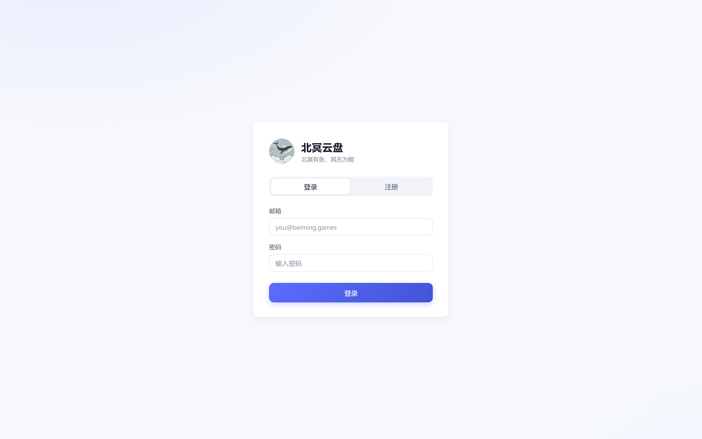

---

## 界面

| 我的文件 | 文档目录 |
|---|---|
|  | 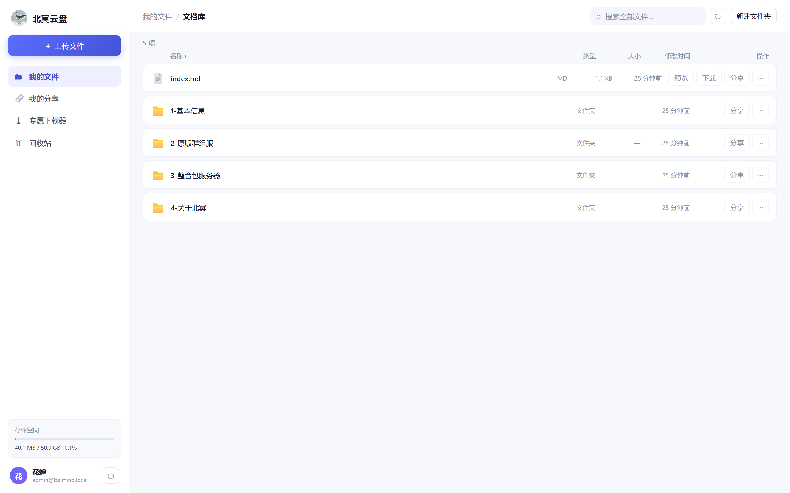 |

| 在线预览（Markdown / 图片 / 视频 / PDF） | 移动到另一个目录 |
|---|---|
| 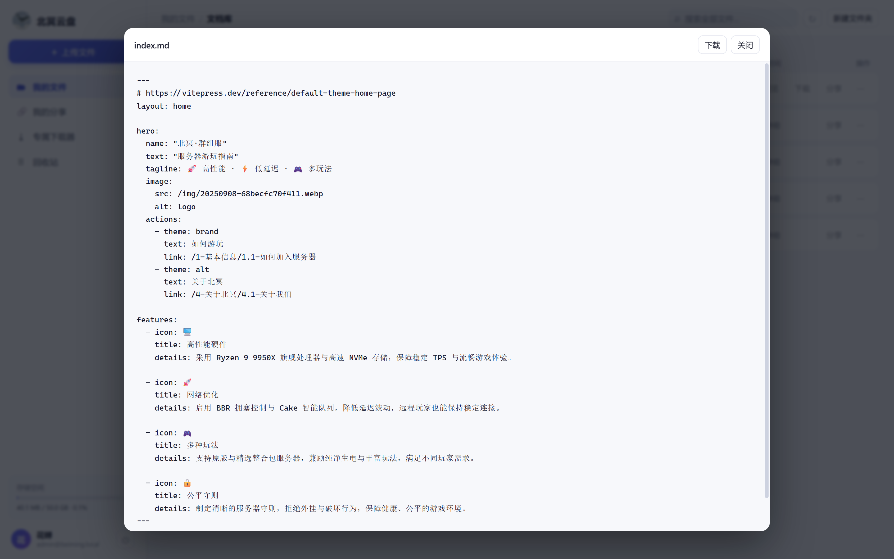 | 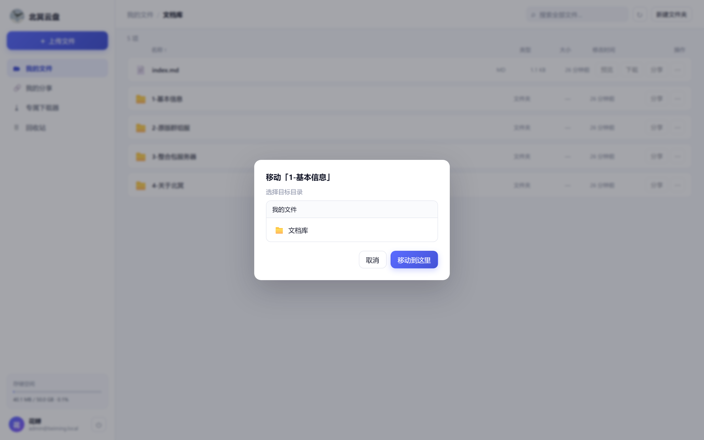 |

**右键菜单** —— 行上右键给这条目的操作，空白处右键给上传/新建/刷新：

| 文件行 | 空白处 |
|---|---|
| 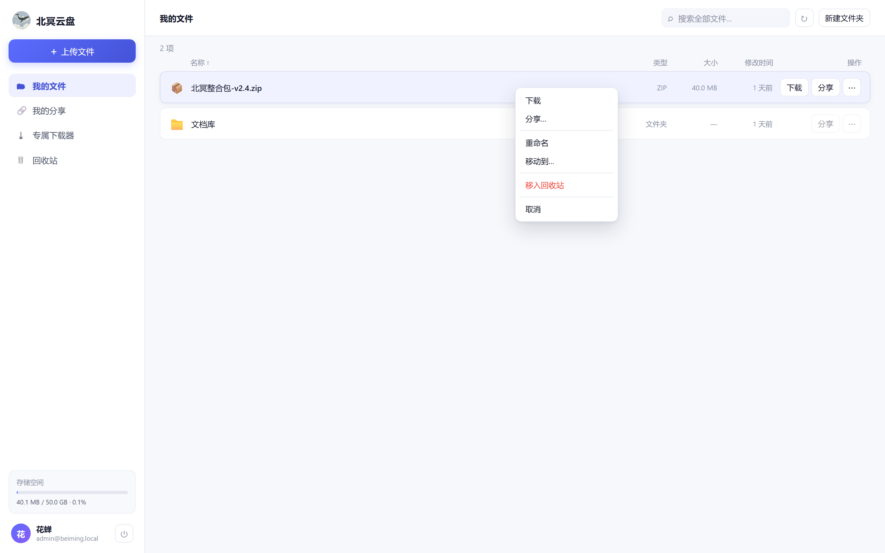 | 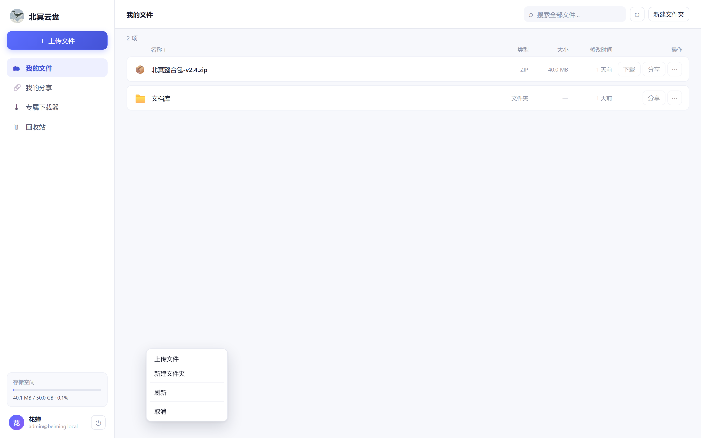 |

改名和删除都是自己画的对话框，不用浏览器原生弹窗——原生的没法校验，也压不了样式：

| 重命名 | 移入回收站 |
|---|---|
| 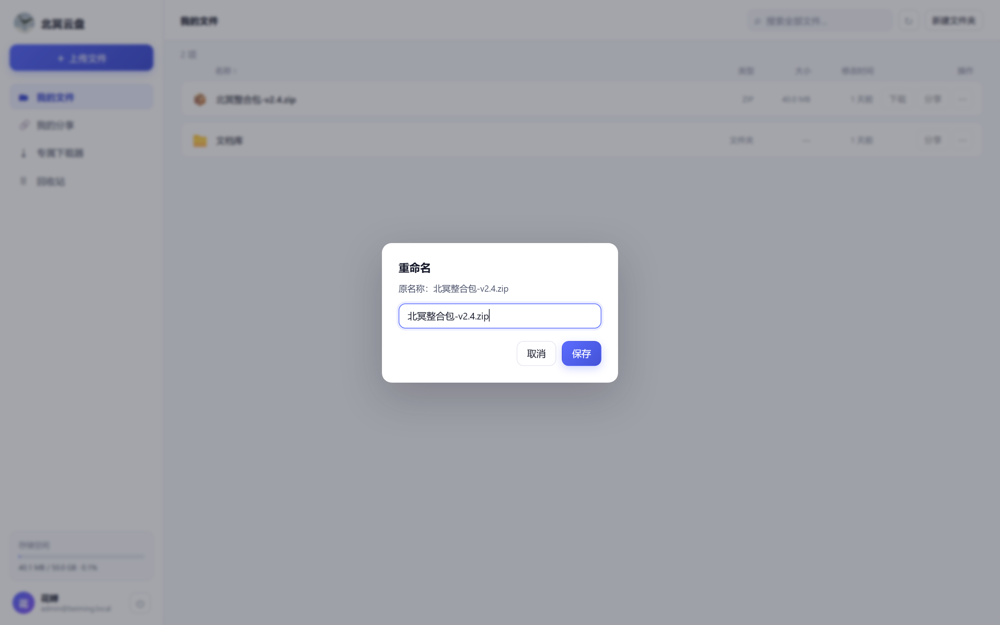 | 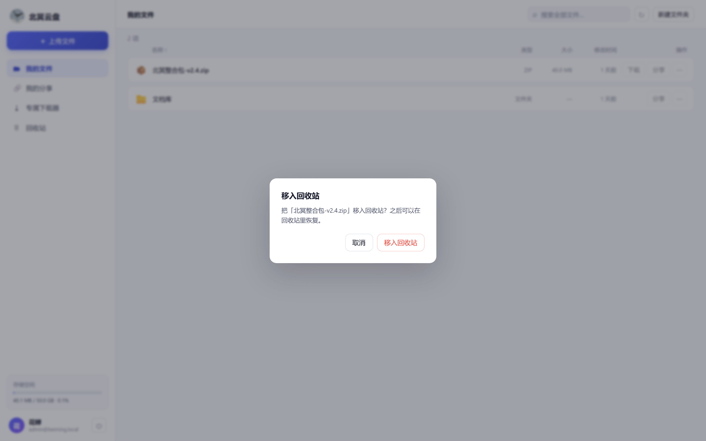 |

**右侧竖栏与新建菜单** —— 竖栏收起只占 62px，鼠标移进去才提示可打开；顶栏的十字按钮点开是四种新建方式：

| 竖栏（收起 / 展开） | 新建菜单 |
|---|---|
| 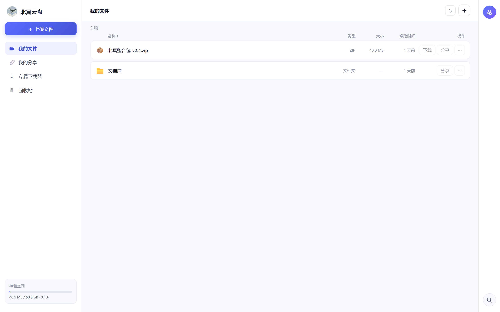 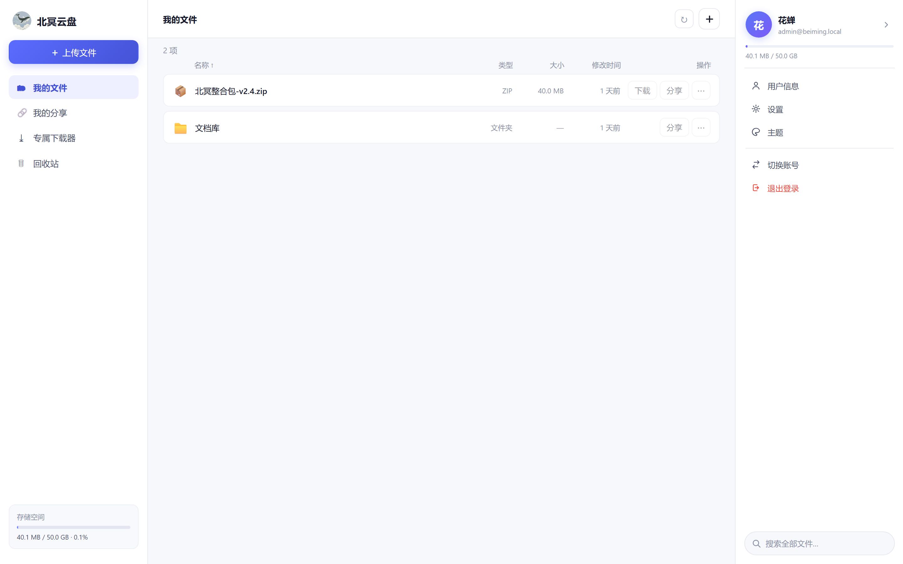 | 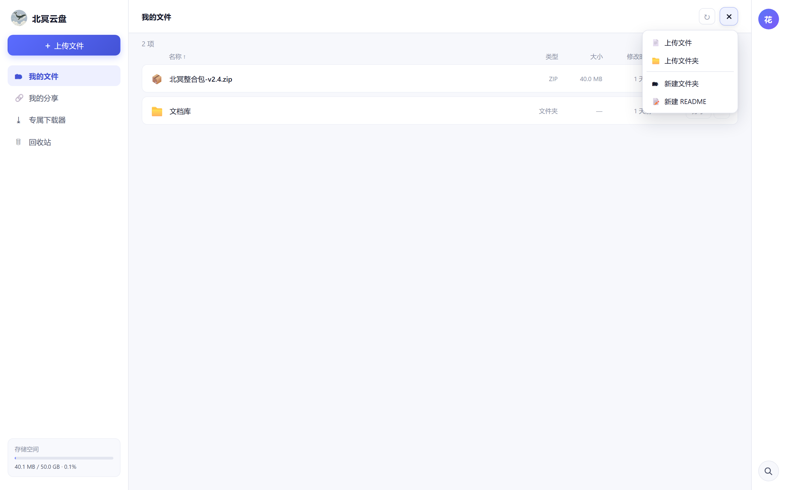 |

**专属下载器** —— 服务端多线程分段，任务跑在服务器上，人关掉浏览器也继续下：

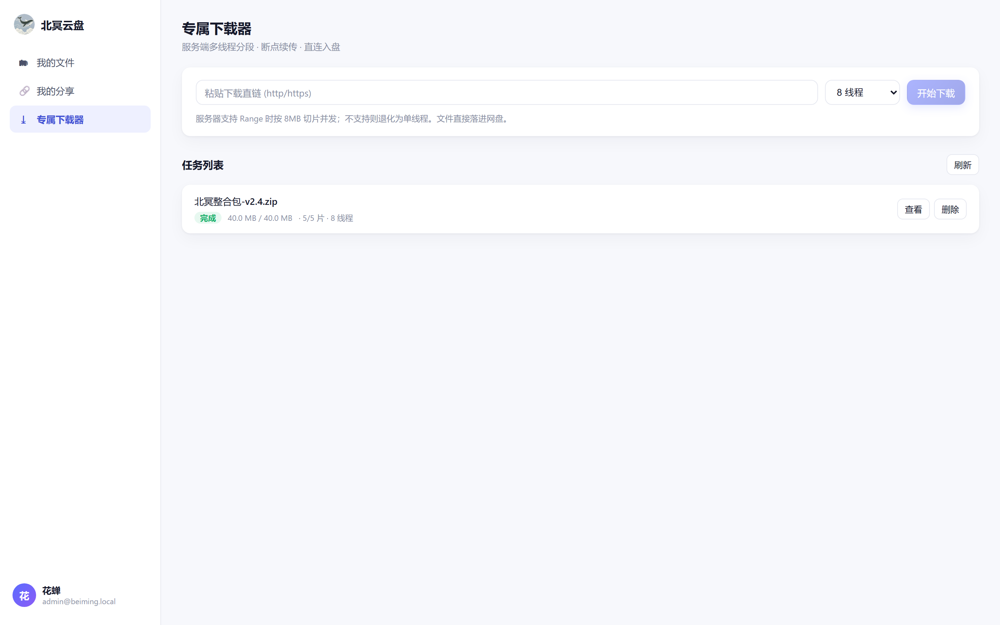

> 截图都是脚本真跑出来的（`scripts/take_screenshots.py` 通过 CDP 驱动真实浏览器），不是手绘示意图。

## 架构

```
                  ┌─────────────────────────────────────────┐
  浏览器  ───────▶ │  drive-app            单端口 :8140      │
                  │  ┌──────────────┐  ┌──────────────────┐ │
                  │  │  Vue 3 SPA   │  │  Spring Boot API │ │
                  │  │  (静态托管)   │  │  /api/v1/**      │ │
                  │  └──────────────┘  └────────┬─────────┘ │
                  └─────────────────────────────┼───────────┘
                                                │
                       ┌────────────────────────┼────────────────────┐
                       ▼                        ▼                    ▼
                ┌──────────────┐        ┌──────────────┐    ┌──────────────┐
                │  卷 blobs    │        │  卷 pgdata   │    │  卷 remote   │
                │ 文件实体      │        │ PostgreSQL 16│    │ 下载临时分片  │
                │ sha256 分层   │        │ 用户/目录/分享│    │              │
                └──────────────┘        └──────────────┘    └──────────────┘
```

**为什么单端口**：前端构建产物由后端静态托管，不需要额外 nginx。少一个进程就少一处出错的地方。

**为什么 blob 按 sha256 分层**：前两位做目录（`ab/cd/abcdef...`），单目录文件数不膨胀，同时天然去重——同样内容上传两次只占一份空间。

## 技术栈

- **后端**：Java 21 + Spring Boot 3.3.5 + Spring JDBC + Flyway + jjwt
- **数据库**：PostgreSQL 16（容器 `drive-postgres`，不对外暴露端口，只有 app 容器能连）
- **前端**：Vue 3 + Vite，构建产物由后端同端口托管（**单端口 8140**）

## 部署（Linux 服务器 / 任何有 Docker 的机器）

这是推荐方式，也和生产环境一致。一条命令起完整栈（PostgreSQL + 后端 + 前端）：

```bash
cd beiming-drive

# 1. 准备凭据（三个值必须改，尤其密码和 JWT 密钥）
cp .env.example .env
vi .env

# JWT 密钥最好随机生成，长度必须 >= 32 字节，否则后端启动即失败
sed -i "s|^DRIVE_JWT_SECRET=.*|DRIVE_JWT_SECRET=$(openssl rand -hex 32)|" .env

# 2. 构建并启动
docker compose -f compose.prod.yml up -d --build

# 3. 看状态
docker compose -f compose.prod.yml ps
docker compose -f compose.prod.yml logs -f app
```

打开 `http://<服务器IP>:8140`。**第一个注册的用户自动成为 ADMIN**，所以部署完第一时间去注册，别等。

### 数据在哪

全部在 Docker 命名卷里，重建容器不丢：

| 卷名 | 内容 |
|---|---|
| `pgdata` | PostgreSQL 数据库（用户、目录树、分享） |
| `blobs` | 文件实体，按 sha256 分层存储 |
| `remote` | 远程下载的临时分片 |

备份就备份这三个卷。`blobs` 是重点，丢了文件内容就没了。

```bash
# 备份 blobs
docker run --rm -v beiming-drive_blobs:/data -v $(pwd):/backup alpine \
  tar czf /backup/blobs-$(date +%F).tar.gz -C /data .
```

### 常用运维

```bash
docker compose -f compose.prod.yml restart app     # 只重启后端
docker compose -f compose.prod.yml down            # 停栈，数据保留
docker compose -f compose.prod.yml up -d --build   # 改代码后重建
```

## 本地开发（如果要在 Windows 上改代码）

```bash
# 只起数据库，后端和前端在本机跑，方便调试
docker compose up -d

# 后端（默认连 127.0.0.1:5440）
C:\Users\15780\dev\apache-maven-3.9.16\bin\mvn.cmd -B -DskipTests -f backend\pom.xml package
C:\Users\15780\dev\jdk-21\bin\java.exe -jar backend\target\beiming-drive-0.1.0-SNAPSHOT.jar

# 前端热更新
cd frontend && npm run dev    # 5174，代理到 8140
```

容器部署时**第一个注册的账号自动成为 ADMIN**，密码由你自己设定，仓库里不存任何初始密码。

本地开发同理：空库第一次访问注册页，你填的账号就是管理员。

## 已经真跑通的能力（都有实测数字）

| 能力 | 验证结果 |
|---|---|
| 用户认证 | 注册/登录/登出，JWT + 会话吊销表，首个用户自动 ADMIN |
| 数据库迁移 | Flyway 在真实 PostgreSQL 建出 9 张表，`flyway_schema_history` success=t |
| 目录树 | 建/列/改名/移动，path 全路径唯一，改名级联更新子树 |
| 回收站 | 移入/恢复/彻底删除，配额随进出加减 |
| 小文件直传 | multipart，sha256 由服务端算并校验 |
| 大文件分片 | 会话 + 逐片 PUT + 合并，断点续传按 `.part` 保留 |
| **HTTP Range 下载** | `206` + `Content-Range: bytes 0-99/1950`，末尾 N 字节 `bytes 1900-1949/1950` |
| **多线程分段下载器** | 40MB → `chunks_total=5` / `chunks_done=5`，0.8 秒，sha256 与源文件完全一致 |
| 分享 | 短链 token、提取码、有效期、限次，匿名访问页 `/s/{id}` |
| blob 存储 | 按 sha256 分层（前 2/2 位做目录），同内容自动去重 |
| 全局搜索 | 跨目录模糊匹配，中文路径正常 |
| 排序 | name / size / updatedAt，升降序，文件夹恒在前 |
| **移动** | 目录选择器，拒绝成环与重名，子树 path 级联（3 层实测） |
| **在线预览** | 图片/视频/音频/PDF/文本，Range 支持拖动进度条，html/svg 拒绝内联 |
| **右键菜单** | 行上右键给该条目的操作，空白处右键给上传/新建/刷新；贴边自动翻转 |
| **顶栏新建菜单** | 圆角方框 + 十字，展开后可上传文件、上传文件夹（按目录结构逐级落位）、新建文件夹、新建 README |
| **右侧竖栏** | 收起时只有头像与放大镜，展开后有账号信息/存储/设置/主题/切换账号/退出，底部胶囊搜索框 |

## 目录结构

```
beiming-drive/
├── backend/                    Spring Boot 后端
│   └── src/main/java/games/beiming/drive/
│       ├── auth/               认证：JWT、拦截器、当前用户
│       ├── fs/                 文件系统：目录树、下载 Range、分片上传
│       ├── share/              分享：短链、匿名访问
│       ├── remote/             多线程分段下载器内核
│       ├── storage/            BlobStore（sha256 分层去重）
│       ├── web/                前端静态托管（同端口交付）
│       └── common/             统一响应、错误码、全局异常
├── frontend/                   Vue 3 前端
│   └── src/pages/              Login / Home / Shares / Downloader / ShareView
├── scripts/
│   └── sync_docs.py            把文档库 md 增量同步进网盘
├── data/
│   ├── blobs/                  blob 存储（sha256 命名）
│   ├── remote/                 远程下载临时分片
│   └── pgdata/                 PostgreSQL 数据（容器挂载）
├── compose.yml                 drive-postgres 容器定义
└── start.bat                   一键启动
```

## 端口

| 端口 | 用途 |
|---|---|
| 8140 | 后端 API + 前端页面（单端口，唯一对外入口） |

数据库**不对外暴露端口**（`compose.prod.yml` 里 postgres 没有 `ports`），只有 app 容器能连。
本地开发时用的是另一份 `compose.yml`，那里把 5440 映射出来方便你用客户端连。

## 踩过的坑（都已修，写在这里防复发）

**1. `GeneratedKeyHolder.getKey()` 在 PostgreSQL 上会炸**
报 `current key entry contains multiple keys`。因为 PG 的 `RETURN_GENERATED_KEYS` 回整行。
必须 `prepareStatement(sql, new String[]{"id"})` 显式指定列。

**2. Spring 的路径正则不允许捕获组**
`@GetMapping("/{name:...\\.(png|ico)")` 里的括号是捕获组，会在**路由匹配阶段**抛
`IllegalArgumentException: No capture groups allowed in the constraint regex`，
表现是**所有静态资源 500**，而且和 handler 代码无关。后缀要在方法体里判断。

**3. 返回 `ResponseEntity<Resource>` 托管静态文件会 500**
Spring 的 message converter 处理 `UrlResource` 时出异常。直接写 `OutputStream`。

**4. Vite 代理 `/s` 会误伤 `/src/main.js`**
`/s` 前缀匹配到了源码路径，整个前端被转发给后端，页面白屏且控制台无报错。
代理只挂 `/api`。

**5. 窄窗口下 `flex: 3` 的名称列会被挤成 0 宽**
766px 窗口实测 name 宽度 = **0**。固定列总宽超了可用空间。
改成 `flex: 1 1 0` + `min-width: 120px`，窄屏用媒体查询隐藏次要列。

**6. jar 被运行中的进程占用，`mvn package` 报 Unable to rename**
改代码后重新打包前必须先停掉 8140 的 java 进程。

**7. git-bash 里 curl 发中文会变 GBK**
`-d '{"nickname":"花蝉"}'` 服务端收到非 UTF-8 字节报 `Invalid UTF-8 start byte 0xbb`。
用 Python 发请求，或写成文件再 `--data-binary @file`。

**8. `.bat` 不能写 UTF-8 中文注释**
cmd.exe 按 GBK 解析，中文注释吃掉 `REM` 后把后半行当命令执行，启动器静默失败。
（`C:\Users\15780\beiming-pan\start-all.bat` 就栽过这个）

## 文档库合并

38 篇 markdown 已同步进网盘 `文档库/` 目录，保持原目录结构：

```bash
python scripts/sync_docs.py            # 增量同步（sha256 相同的跳过）
python scripts/sync_docs.py --dry-run  # 只看会传什么
```

实测：11 个目录 / 38 个文件 / 111.6 KB，与源目录字节数一致。

## 回收站与磁盘回收

**保留 30 天后自动彻底删除**（每天凌晨 3 点，容器时区 `Asia/Shanghai`）。
计时基准是移入回收站的时刻，到期由后台任务清掉，磁盘实体同时释放。

### 为什么「删了」不等于「空间回来了」

blob 按 sha256 去重，同一份内容可能被多个条目引用，也可能被某个用户的头像引用。
所以「删一行数据库记录」和「删一份磁盘文件」是两件事 ——
某个 sha 只要还有一处引用，实体就不能动。

彻底删除走两步：先删记录（事务内），再释放没被引用的实体（事务外）。
第二步必须在事务外：文件系统没有回滚，把它放进事务里，一旦回滚就会出现
「记录还在、文件没了」，点开是个 404，比没删更糟。

释放失败不影响正确性：记录已经没了，剩下的孤儿 blob 由定时对账兜底收掉。

### 回收站用独立命名空间

移入回收站时，路径从 `/<原名>` 搬到 `/.trash/<节点id>`，原路径记进 `original_path`，
恢复时搬回去。

为什么：`uq_drv_node_path` 是 `UNIQUE (owner_id, path)`，**不区分 status**。
回收站条目如果还占着原路径，用户删掉再上传一个同名文件就会撞唯一约束报 500。
放进独立命名空间，可见区和回收站就永远不打架。

回收站界面只列**顶层**条目：删一个文件夹时整棵子树都搬进回收站（恢复时才能整棵回来），
但列表只显示这个文件夹，不会把里面的文件一条条摊出来。

### 可调配置

| 环境变量 | 默认 | 说明 |
|---|---|---|
| `DRIVE_TRASH_RETENTION_DAYS` | `30` | 保留天数 |
| `DRIVE_TRASH_CRON` | `0 0 3 * * *` | 清理任务执行时间（六段 cron） |
| `DRIVE_TRASH_ENABLED` | `true` | 关掉可以停用自动清理 |
| `DRIVE_GC_GRACE_MINUTES` | `30` | 孤儿清扫的冷静期，见下 |

### 冷静期在防什么

全盘对账时会跳过「最近 30 分钟内修改过」的 blob。这不是保守，是必要的：
上传大文件时 `BlobStore.put` 会先把内容落盘、再插数据库记录，中间有个窗口期。
清算任务要是正好在这个窗口跑，会把一份正在入库的文件当成孤儿删掉。

精确释放（用户点彻底删除后立刻触发）**没有**冷静期 —— 它拿到的 sha 都是从库里查出来的，
说明它们早就入库过，不存在这个中间态。用户点了删除就该当场看到空间回来。

### 想马上清一次

自动任务只在凌晨跑，但「现在就想清」是真实需求（磁盘快满了、或者刚改完保留天数想验证）。
管理接口（仅 ADMIN）：

```bash
# 先看会删什么、能释放多少，不动手
curl -H "Authorization: Bearer $TOKEN" "http://127.0.0.1:8140/api/v1/admin/storage/gc?dryRun=true"

# 真跑一轮（清过期回收站 + 全盘孤儿对账）
curl -X POST -H "Authorization: Bearer $TOKEN" http://127.0.0.1:8140/api/v1/admin/trash/cleanup
```

两个接口都幂等：没有到期的、没有孤儿的，跑十次也不会有任何变化。

### 端到端验证

```bash
python scripts/verify/verify_trash.py
```

自建一个测试账号跑完整流程（删文件夹→回收站只列顶层→彻底删除释放磁盘→
去重共用→31 天清理→29 天不清→恢复重名让路→孤儿对账），跑完连账号一起删掉，不动线上数据。
最后一次实跑 37 项全过。

## 还没做

- 备份脚本（pgdata / blobs / remote / searchidx 四个卷目前零备份）
- 并入 `beiming-official-website` 的模块化单体（等这个跑稳再决定）

~~分享转存~~ —— 已完成：分享页「保存到我的网盘」，零拷贝（复用 sha256 blob）+ 自动改名避让。
~~多用户协作、共享目录~~ —— 已完成，见 V8 共享树 + ACL。
~~离线部署~~ —— 已完成，`compose.prod.yml` 全容器化（app + postgres）。
~~回收站自动清理（30 天）~~ —— 已完成，见下面「回收站与磁盘回收」。

## 和旧项目的关系

`C:\Users\15780\beiming-pan` 是上一版（Cloudreve 换前端 + Python 旁挂）。那个方向是错的：
Cloudreve 后端闭源，改不了内核。保留它只作为数据导入来源和参照，不再演进。